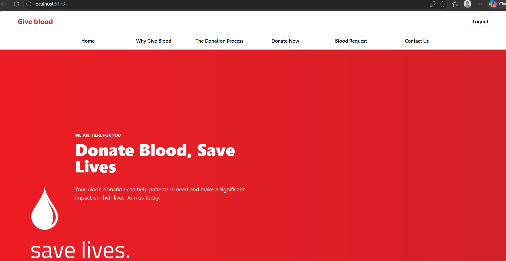
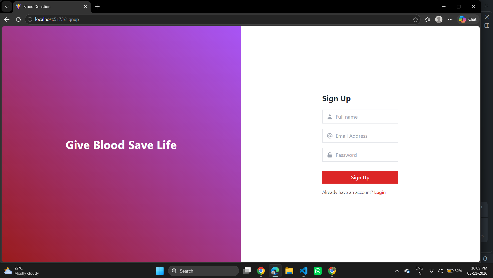

# 🩸 Blood Donation – Give Blood Save Life

A web-based Blood Donation Platform developed using the MERN Stack (MongoDB, Express.js, React.js, and Node.js). The application aims to encourage blood donation, provide information about the donation process, and help users participate in blood donation activities.

## 📌 Project Overview

Blood donation plays an important role in saving human lives. Many patients require blood during emergencies, surgeries, accidents, and long-term medical treatments.

This project provides a web platform where users can explore blood donation information, understand the importance of donating blood, register or log in, and access blood donation and blood request sections.

The main goal is to create awareness about blood donation and provide a simple digital platform for blood donation activities.

## 🎯 Objectives

- Create awareness about the importance of blood donation.
- Encourage people to become regular blood donors.
- Provide information about blood donation benefits.
- Explain the blood donation process.
- Provide user registration and login functionality.
- Provide sections for donating blood and requesting blood.
- Develop a simple and user-friendly web interface.

## ✨ Features

### 1. Home Page
- User-friendly landing page.
- Simple navigation to different sections.
- Easy access to registration and login.

### 2. Why Give Blood?
- Information about the importance of blood donation.
- Benefits of donating blood.
- Awareness content about saving lives.
- Blood donation awareness video section.

### 3. The Donation Process
- Information about the blood donation process.
- Guidance to understand the different stages of donation.

### 4. User Registration
- New user registration.
- User account creation.

### 5. User Login
- Existing user login.
- Authentication through the backend.

### 6. Donate Now
- Dedicated section for blood donation activities.

### 7. Blood Request
- Dedicated section for blood requests.

### 8. Contact Us
- Contact section for user communication.

## 🛠️ Technology Stack

| Technology | Purpose |
|---|---|
| React.js | Frontend development |
| JavaScript | Application logic |
| Tailwind CSS | UI styling |
| Node.js | Backend runtime |
| Express.js | Backend API development |
| MongoDB | Database |
| Mongoose | MongoDB object modeling |
| Redux Toolkit | State management |
| Axios | API communication |
| Material UI | UI components |

## 🏗️ System Architecture

The project follows the MERN Stack architecture.

**Frontend – React.js**

The frontend provides the user interface and communicates with the backend using API requests.

**Backend – Node.js and Express.js**

The backend handles application requests, user authentication, and communication with the database.

**Database – MongoDB**

MongoDB stores the application's data.

### Application Flow

1. Users interact with the React frontend.
2. Frontend sends requests to the Express.js API.
3. Node.js processes the requests.
4. Mongoose communicates with MongoDB.
5. Backend returns responses to the frontend.
6. React updates the interface based on the response.

## 📂 Project Structure

```text
blood-donation/
│
├── backend/
│   ├── config/
│   │   └── database.js
│   ├── controllers/
│   │   └── userController.js
│   ├── routes/
│   │   └── userRoute.js
│   ├── index.js
│   ├── package.json
│   └── ...
│
├── frontend/
│   ├── src/
│   │   ├── Components/
│   │   │   ├── About.jsx
│   │   │   ├── BloodRequest.jsx
│   │   │   ├── Contact.jsx
│   │   │   ├── Donate.jsx
│   │   │   ├── Footer.jsx
│   │   │   ├── Header.jsx
│   │   │   ├── HomePage.jsx
│   │   │   ├── Login.jsx
│   │   │   ├── Signup.jsx
│   │   │   ├── Thedonationprocess.jsx
│   │   │   ├── Whygiveblood.jsx
│   │   │   └── redux/
│   │   ├── App.jsx
│   │   └── main.jsx
│   ├── package.json
│   └── ...
│
└── README.md
```

## ⚙️ Installation and Setup

### Prerequisites

Install the following software before running the project:

- Node.js
- npm
- MongoDB Atlas account or MongoDB server
- Visual Studio Code
- Git

### Step 1: Clone the Repository

```bash
git clone https://github.com/DHANUSHNAGARAJ123/blood-donation.git
```

### Step 2: Navigate to the Project

```bash
cd blood-donation
```

### Step 3: Backend Setup

```bash
cd backend
npm install
```

Create a `.env` file inside the backend folder and configure your MongoDB connection:

```env
PORT=8000
MONGO_URI=your_mongodb_connection_string
```

Start the backend server:

```bash
npm start
```

### Step 4: Frontend Setup

Open another terminal:

```bash
cd frontend
npm install
npm run dev
```

### Step 5: Open the Application

Open the frontend in your browser:

```text
http://localhost:5173
```

Backend server:

```text
http://localhost:8000
```

*Note: Use the start scripts specified in each package.json if they differ from these commands.*

## 🔐 Environment Configuration

Keep database credentials and other secret keys inside the `.env` file.

Do not upload sensitive credentials to GitHub.

Make sure `.env` is included in `.gitignore`.

### 📸 Project Screenshots

All screenshots are available in the `screenshots` folder.

#### 1. Home Page


#### 2. Why Give Blood


#### 3. Blood Request


#### 4. Donate Now


#### 5. User Registration


#### 6. Contact Us

## 👨‍💻 Developer

**Dhanush Nagaraj**

B.Tech – Artificial Intelligence and Data Science

GitHub: https://github.com/DHANUSHNAGARAJ123

Project Repository: https://github.com/DHANUSHNAGARAJ123/blood-donation

## 📄 License

This project is developed for educational and learning purposes.

---

**Give Blood. Save Lives. Be Someone's Hero! ❤️**
